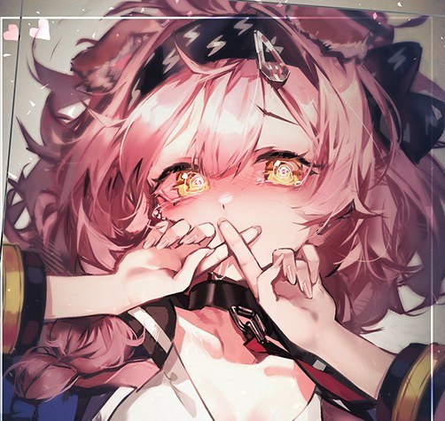
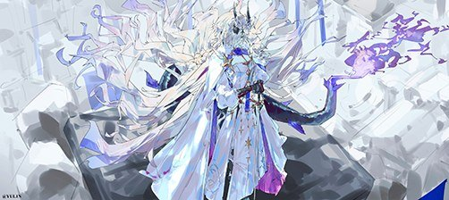
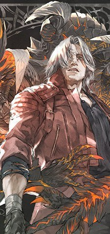
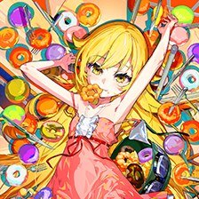
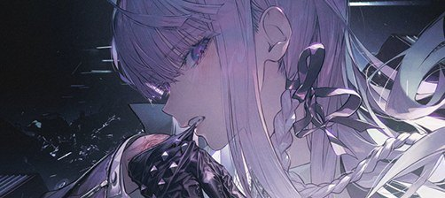

 

  

## ✧ About

### ~~神~~

> 在 -459.67℉ 下游荡
> 
> 在 1515℃ 中寻得被抹去的痕迹
>
> 在 5660℃ 上熠烁

 

  

## ✧ Likes

| 属性 | 值 |
| :--- | :--- |
|  | 不死斬り |
|  | DELTARUNE |
|  | 舞い戻った死神|

  <h2>!中剧毒了!</h2>

  

## ✧ Skills

  

  

## ✧ Data

  

  
  

  

  

✧ MORE

### Recently

- 预备jam
- 推进项目

### Want

- 完成我的同人项目
- 等到MOSS二次元特调
- 希望能学会BlockBench,Spine...希望能更深入学习Unity,Godot,Unreal...

### Found

  

## ✧ ???

<!-- GALLERY:START 本区块由 build.py 自动生成，手改会被覆盖 -->
<table align="center">
  <tr>
    <td align="center" colspan="2" rowspan="2"></td>
    <td align="center" colspan="2"></td>
    <td align="center"></td>
    <td align="center" rowspan="2"></td>
  </tr>
  <tr>
    <td align="center"></td>
    <td align="center"></td>
    <td align="center"></td>
  </tr>
  <tr>
    <td align="center" colspan="2"></td>
    <td align="center" rowspan="2"></td>
    <td align="center"></td>
    <td align="center"></td>
    <td align="center"></td>
  </tr>
  <tr>
    <td align="center" colspan="2"></td>
    <td align="center"></td>
    <td align="center" colspan="2"></td>
  </tr>
</table>
<!-- GALLERY:END -->

喜欢的图 · 厨力 · 纪念 —— 神的画册

「就从0°开始」

